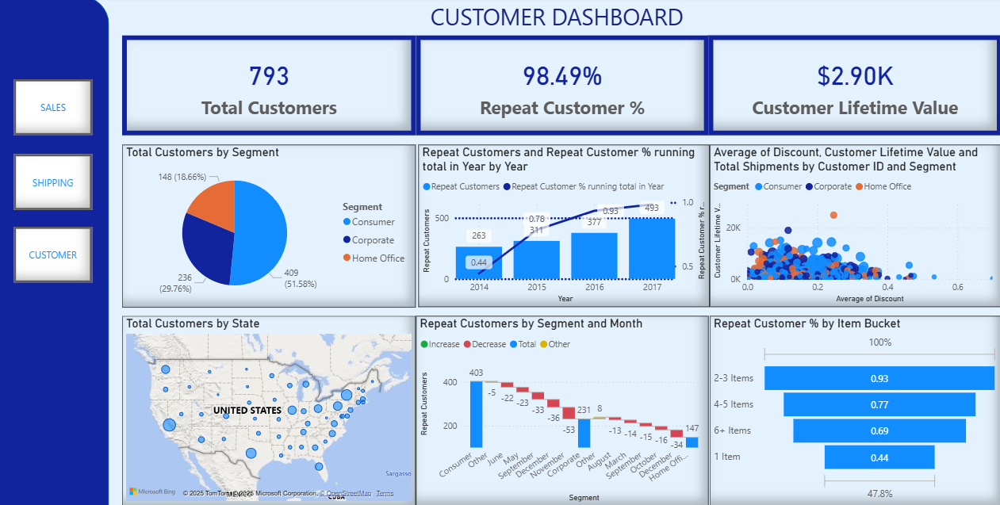
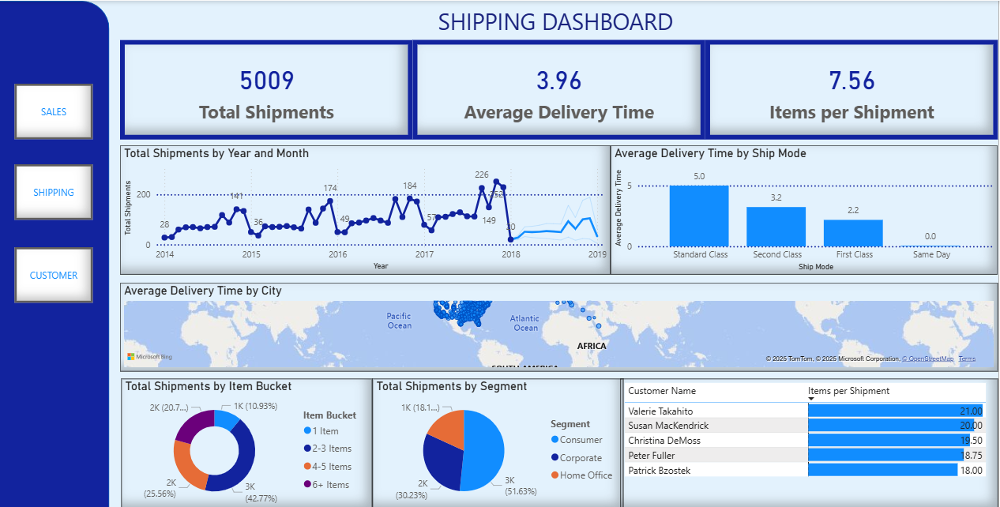
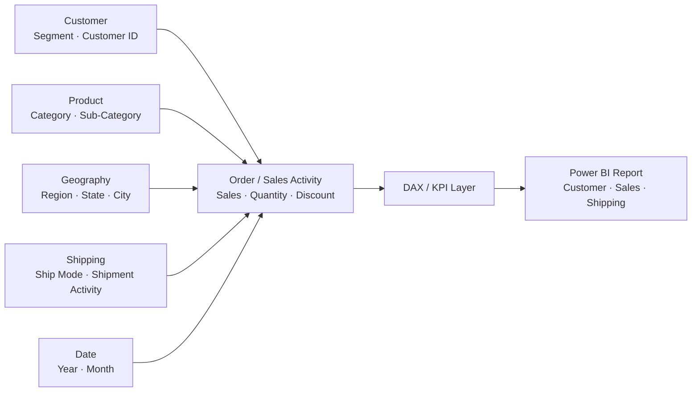

# Superstore Customer, Sales & Shipping Analytics — Power BI

**Power BI · DAX · Customer Analytics · Sales Performance · Logistics · CLV**

This project analyzes the Superstore dataset through a multi-page **Power BI dashboard suite** focused on customer behavior, sales performance, shipping activity, and discount effectiveness.

Rather than presenting a single generic sales dashboard, the project separates the analysis into distinct business views so decision-makers can understand **who buys, what drives revenue, how products move, and where customer value is concentrated**.

---

## Dashboard Preview

### Customer Analytics



Focuses on repeat behavior, customer segmentation, item-volume patterns, and customer value.

### Sales Performance


Focuses on category, sub-category, regional, and customer-segment performance.

### Shipping & Logistics



Focuses on shipment volume, shipping mode, geography, and operational distribution patterns.

---

## Executive Summary

The goal of this project was to turn transactional retail data into a structured BI story across three business areas:

1. **Customer Analytics** — identify repeat behavior, loyalty patterns, and higher-value customer segments.
2. **Sales Performance** — understand which products, categories, regions, and segments contribute most to revenue.
3. **Shipping & Logistics** — evaluate shipment patterns by shipping mode, location, and order volume.

The analysis also explores the relationship between **discount behavior and Customer Lifetime Value (CLV)** to understand whether promotional activity aligns with stronger customer economics.

---

## Business Questions

The dashboard suite was designed to answer practical business questions such as:

- Which customer segments show the strongest repeat-purchase behavior?
- How does repeat behavior change by item volume and year?
- Which categories and sub-categories contribute the most sales?
- Which regions and customer segments drive revenue?
- How does shipping activity vary by mode, city, and order volume?
- Are deeper discounts associated with stronger customer value?
- Which customer groups represent the best retention and growth opportunities?

---

## Analytical Approach

```text
Superstore Transaction Data
          │
          ▼
Data Preparation & Modeling
          │
          ▼
DAX Measures & Segmentation
          │
          ├── Customer Metrics
          ├── Sales Metrics
          ├── Shipping Metrics
          └── CLV / Discount Analysis
          │
          ▼
Multi-Page Power BI Dashboard
          │
          ▼
Business Insights & Recommendations
```

---

## Conceptual Data Model

The dashboard follows a simplified retail BI model where transactional sales activity is analyzed through customer, product, geographic, and fulfillment dimensions.



---

## Key Findings

- Customers purchasing **2–3 items per shipment** showed stronger repeat behavior in the analyzed data.
- The **Consumer** segment represented the largest share of shipment and quantity activity.
- Sales and loyalty performance were concentrated among a subset of states and customer segments.
- Discounting did not show the same relationship with customer value across all segments, suggesting that **blanket discount strategies may not produce the same return for every customer group**.
- Breaking performance into customer, sales, and shipping views made it easier to distinguish commercial outcomes from fulfillment behavior.

---

## Dashboard Areas

### 1. Customer Analytics

The customer view examines:

- repeat-customer behavior;
- loyalty trends over time;
- customer segmentation;
- item-volume buckets;
- CLV patterns;
- discount behavior by customer type.

### 2. Sales Analytics

The sales view evaluates:

- sales by category and sub-category;
- regional performance;
- segment performance;
- product mix;
- geographic concentration;
- sales trends and comparative performance.

### 3. Shipping Analytics

The logistics view evaluates:

- shipment activity by shipping mode;
- shipment volume by city;
- item and quantity movement;
- operational distribution patterns;
- customer and geography differences in shipping behavior.

---

## Business Recommendations

Based on the analysis, the project supports several practical recommendations:

- Prioritize retention efforts toward customer groups demonstrating stronger repeat behavior.
- Use category, sub-category, and regional performance together when allocating sales attention.
- Avoid assuming that larger discounts automatically create higher-value customers.
- Review shipping activity by mode and geography to identify potential operational concentration or inefficiency.
- Use CLV and repeat behavior alongside topline sales when evaluating customer segments.

---

## Technologies & Skills

### Technologies

- Power BI
- DAX
- Power Query / data preparation

### Skills Demonstrated

- Data modeling
- KPI development
- Customer segmentation
- Customer Lifetime Value analysis
- Retention / loyalty analysis
- Sales performance analysis
- Shipping and logistics analysis
- Discount effectiveness analysis
- Interactive dashboard design
- Business storytelling
- Executive reporting

---

## Repository Structure

```text
Superstore-Analytics/
│
├── Customer.png     # Customer analytics dashboard
├── Sales .png       # Sales performance dashboard
├── Shipping.png     # Shipping / logistics dashboard
└── README.md        # Portfolio case study
```

---

## What This Project Demonstrates

This project demonstrates my ability to take transactional retail data and turn it into a structured Power BI reporting experience for different business audiences.

It shows the complete BI thought process:

**Business Question → Data Model → DAX Measures → Segmentation → Dashboard → Insight → Recommendation**

The project complements my larger portfolio by demonstrating core **Power BI, DAX, customer analytics, operational reporting, and business intelligence** skills in a visual format that recruiters and hiring managers can review quickly.

---

## Author

**Muzammil Paracha**  
Data Analytics · SQL · Power BI · Databricks · Business Intelligence · Data Engineering
